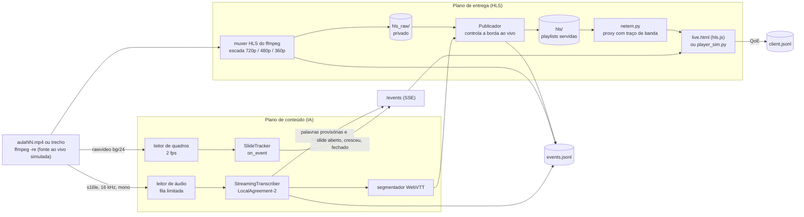
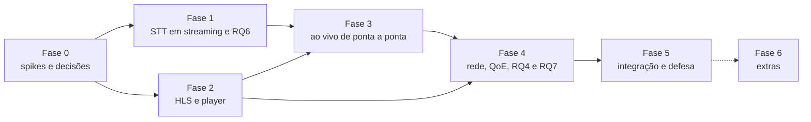

# Plano: F10, FalAI Ao Vivo

**Legenda, slides e busca em tempo quase real sobre HLS, com latência e QoE medidas**

> **Estado: DESCARTADO em 2026-11-12** (decisão do usuário: o modo ao vivo não vai ser feito). Fica só como
> registro; a proposta atual é [plano_contexto_cruzado.md](plano_contexto_cruzado.md). Nada disto está
> implementado. Não altera F1 a F5 nem a RQ1.
> **Para entrar no projeto**, depende das decisões da seção 12 (escopo, contrato do `raw.csv`, grade de
> fatores). Até lá, tudo aqui é `[PREMISSA]`. Estimativas de esforço e de tempo de execução são
> `[PLACEHOLDER]`: chute de planejamento, não medição.

---

## 0. Resumo

Hoje o FalAI processa a aula **depois** que ela acabou (plano de conteúdo, offline) e entrega o resultado
como arquivo estático. A parte de **rede** do enunciado (F8, RQ4) ainda não existe, e a fronteira
"análise × transporte" só aparece no texto.

A proposta é um **modo ao vivo**: a aula sai como fluxo HLS e, ao mesmo tempo, um STT em streaming gera a
legenda, o `SlideTracker` detecta os slides e a página permite buscar o que já foi dito e voltar àquele
instante. Tudo instrumentado, para responder a uma pergunta que só este trabalho pode fazer:

> **A latência que o próprio HLS já impõe (≈ 3 segmentos) é suficiente para esconder a latência da
> legenda gerada por IA? Com qual modelo, tamanho de bloco e duração de segmento isso deixa de valer, e
> quanto a IA rodando na mesma máquina degrada a entrega?**

É difícil porque junta quatro problemas que o projeto ainda não tem: STT incremental (o Whisper não é
streaming), empacotamento HLS ao vivo com legenda segmentada e sincronizada, emulação de rede e medição
de QoE, e um modelo de relógio único entre servidor, IA e player.

---

## 1. Por que esta funcionalidade

| Ganho | Requisito |
|---|---|
| Transforma a fronteira análise × transporte em **experimento medido**, não só em diagrama | Tema 9 ("diferenciar análise de transporte"), RQ4 |
| Estende a pergunta principal (qualidade × tempo) para o caso em que o tempo é **latência**, não RTF | I3, I4 |
| Liga teoria a resultado de forma testável: regra dos 3 segmentos do HLS (RFC 8216, §6.3.3), estabilidade de fila (ρ < 1), ABR por vazão | I5 |
| Arquitetura em dois planos vira código, com um componente que controla a borda ao vivo | I6 |
| A RQ6 (latência × WER) usa **só o gabarito que já vai existir** (trechos da etapa 1). Nenhuma anotação nova | Gargalo da etapa 1 |
| Demo forte: legenda aparecendo enquanto o professor fala, slide entrando no painel, busca no que já foi dito | Defesa, demo |

**Alternativa considerada.** A "apostila" (PDF com slide + o que foi dito durante ele) e o vínculo
slide ↔ fala, junto com a busca da F6, que o usuário já marcou como requisito importante
(docs/decisoes.md, 2026-11-12). É valiosa, mas é toda do plano de conteúdo. O plano de entrega não tem
nenhuma implementação, e é a parte que distingue um trabalho de *Redes* Multimídia. Fica como próximo
candidato; o modo ao vivo até reaproveita o vínculo (o slide ativo durante cada palavra).

---

## 2. Perguntas e hipóteses

Novas RQs, numeradas depois das do CLAUDE.md, seção 4:

| RQ | Pergunta | Hipótese (a ser refutada ou não pelos dados) |
|---|---|---|
| RQ6 | Qual é o custo, em WER e em latência, de transcrever em streaming em vez de offline? | **H1:** WER ao vivo ≥ WER offline do mesmo modelo; a diferença cai quando o bloco (`chunk_s`) cresce. **H2:** a latência p95 explode quando a utilização ρ = tempo médio de um passo / `chunk_s` se aproxima de 1 |
| RQ7 | A legenda chega a tempo dentro da latência do HLS? | **H3:** com segmentos de duração T, a latência ponta a ponta G ≥ 3T dá folga para a IA; existe um T abaixo do qual a fração de legendas a tempo cai, e ela pode ser **prevista** pela distribuição de latência da RQ6 |
| RQ4 (refinada) | Quanto a IA na mesma máquina degrada a entrega ao vivo? | **H4:** STT na CPU disputa com o codificador x264 e aumenta o atraso de produção dos segmentos e o rebuffering; STT na GPU, pouco ou nada |

A RQ4 original ("HLS com e sem IA em paralelo") fica dentro desta: em VOD o servidor só serve arquivos,
e é provável que a IA quase não interfira. O caso interessante é o ao vivo, em que codificação e IA
disputam a mesma máquina.

---

## 3. Arquitetura



**Um processo `ffmpeg`, três saídas.** O mesmo `ffmpeg -re` gera o HLS e entrega áudio PCM e quadros
crus por dois pipes. Assim, mídia, IA e entrega partem do mesmo relógio. Dois `ffmpeg` separados lendo o
mesmo arquivo derivariam um do outro.

**O Publicador é a peça central.** O `ffmpeg` grava em `hls_raw/`, que ninguém serve. O Publicador lê
os segmentos prontos e reescreve as playlists de `hls/`, acrescentando o segmento k (de vídeo e de
legenda) quando a política mandar. Isso dá controle exato sobre a borda ao vivo e registra o instante
de publicação de cada segmento, que é o que as RQ4 e RQ7 medem.

**Sem dependência Python nova no núcleo.** `subprocess`, `threading`, `asyncio` e
`http.server.ThreadingHTTPServer` (que serve arquivos e SSE). O `hls.js` entra como arquivo em
`web/vendor/`, com versão fixada e licença anotada (Apache-2.0) `[VALIDAR]`.

### 3.1 Módulos novos e alterados

| Arquivo | Papel | Depende de |
|---|---|---|
| `src/live_stt.py` | `StreamingTranscriber` (política LocalAgreement-2) e `simulate()` (simulação ciente do custo) | `stt` (parâmetros fixos, `clean_segments`), `metrics.norm` |
| `src/hls.py` | Escada VOD, comando do `ffmpeg` ao vivo, Publicador, segmentador WebVTT, leitor mínimo de `.m3u8` | FFmpeg |
| `src/live.py` | Orquestrador ao vivo (CLI): sobe o `ffmpeg`, as threads leitoras, o STT, o tracker, o Publicador e o servidor | `live_stt`, `hls`, `extract.SlideTracker` |
| `src/netem.py` | Proxy HTTP com banda por traço e atraso; gerador de traços sintéticos com seed | stdlib |
| `src/player_sim.py` | Cliente HLS virtual (ABR por vazão, modelo de buffer), o instrumento principal de QoE | `hls` (leitor de `.m3u8`) |
| `src/extract.py` | **Alteração:** `SlideTracker(on_event=None)`. Com `None`, a saída offline fica idêntica | — |
| `src/run_experiments.py` | `--live-stt` (RQ6), `--live-sync` (RQ7), `--delivery` (RQ4) | os acima |
| `src/report.py` | Tabelas 6 e 7, figuras 5 a 8 (seção 11) | `raw.csv` |
| `web/live.html` | Player ao vivo: legenda provisória e confirmada, slides chegando, busca com volta no DVR, painel de QoE | `hls.js` |
| `src/studio.py`, `web/studio.html` | Tela `#live` que lança `live.py` e mostra o comando CLI equivalente | `live.py` |

---

## 4. Componentes

### 4.1 Fonte ao vivo e empacotamento

A fonte é um arquivo lido em tempo real (`-re`). Para os experimentos é a **única** fonte aceita: o mesmo
áudio em toda execução, com gabarito. Microfone e captura de tela ficam só para a demo (seção 4.9).

Esboço do comando, a validar no spike S1 (seção 8):

```bash
ffmpeg -re -ss <start_s> -t <dur_s> -i data/raw/aula01.mp4 \
  -filter_complex "[0:v]split=3[a][b][t];[a]scale=-2:720[v0];[b]scale=-2:360[v1];[t]fps=2[tap]" \
  -map "[v0]" -map 0:a -map "[v1]" -map 0:a \
  -c:v libx264 -preset veryfast -force_key_frames "expr:gte(t,n_forced*4)" \
  -b:v:0 2500k -b:v:1 700k -c:a aac -b:a 96k \
  -f hls -hls_time 4 -hls_playlist_type event \
  -hls_flags independent_segments+program_date_time+temp_file \
  -var_stream_map "v:0,a:0 v:1,a:1" -master_pl_name master.m3u8 \
  -hls_segment_filename "hls_raw/v%v/seg_%05d.ts" "hls_raw/v%v/index.m3u8" \
  -map "[tap]" -f rawvideo -pix_fmt bgr24 pipe:<fd_quadros> \
  -map 0:a -ac 1 -ar 16000 -f s16le pipe:<fd_audio>
```

- `-force_key_frames` alinha os keyframes à duração do segmento (4 s aqui) qualquer que seja o fps.
- `event` mantém todos os segmentos na playlist, o que permite voltar no tempo (DVR) para a busca.
- `program_date_time` coloca o `EXT-X-PROGRAM-DATE-TIME`, que é o relógio comum entre servidor e player
  (seção 4.8).
- `temp_file` grava segmento e playlist com renomeação atômica. Sem ele, o Publicador lê arquivo pela
  metade.
- Os pipes são `os.pipe()` passados com `subprocess.Popen(pass_fds=...)`. No Linux, o número do
  descritor é o mesmo no filho, então `pipe:<fd>` funciona.

**Armadilha principal (contrapressão).** Se o Python deixar de ler um dos pipes, o buffer do pipe enche,
o `ffmpeg` bloqueia e **o HLS para junto**. Isso faria a IA atrasar a entrega por um defeito do
programa, não por disputa de recursos, e contaminaria a RQ4. Regra: cada pipe tem uma thread leitora que
nunca bloqueia e entrega a uma fila limitada; se a fila encher, descarta o mais antigo e registra
`tap_drop` no `events.jsonl`. Descarte de áudio invalida a execução para a RQ6 e a RQ7 (o script marca).

### 4.2 STT em streaming: `live_stt.StreamingTranscriber`

O Whisper transcreve janelas de até 30 s e não é incremental. A técnica escolhida é a política
**LocalAgreement-2** do Whisper-Streaming (Macháček, Dabre e Bojar, 2023): a cada bloco novo de áudio,
transcreve-se de novo o buffer inteiro e só se **confirma** o prefixo em que as duas últimas hipóteses
concordam. Palavra confirmada nunca muda.

```python
class StreamingTranscriber:
    def __init__(self, asr, trim_s=15.0, prompt_chars=200): ...
    def insert_audio(self, pcm: np.ndarray) -> None: ...   # acrescenta ao buffer
    def process(self) -> Step: ...   # Step(committed=[Word], tentative=[Word], buffer_s, removed)
    def finish(self) -> Step: ...    # fim do fluxo: confirma o que sobrou

# um passo de process():
hyp = asr(buffer, offset=buffer_t0, prompt=texto_confirmado[-prompt_chars:])  # tempos absolutos
hyp = [w for w in hyp if w.end > fim_ultima_confirmada]   # descarta o que já foi confirmado
commit = maior_prefixo_comum(hyp_anterior, hyp)          # compara palavras por metrics.norm
confirmadas += commit; hyp_anterior = hyp[len(commit):]
if duracao(buffer) > trim_s:                              # mantém o buffer curto
    cortar no fim do último segmento do Whisper inteiramente confirmado
```

- **`asr` é injetado.** A implementação real chama `model.transcribe` com os mesmos `stt.LANGUAGE`,
  `stt.BEAM_SIZE`, `stt.VAD_FILTER`, `word_timestamps=True` e consome o gerador. Nos testes, um `asr`
  falso devolve hipóteses roteirizadas (seção 9). Assim a política é testável sem carregar modelo.
- **Filtro de alucinações:** `stt.clean_segments` em cada hipótese, como no offline.
- **Prompt com o texto confirmado:** o artigo do Whisper-Streaming usa; o offline do projeto usa
  `condition_on_previous_text=False`. Muda o WER, então é a decisão L3 (seção 12).

### 4.3 Simulação ciente do custo: `live_stt.simulate`

Rodar a RQ6 em tempo real custaria a duração do trecho por execução. A simulação roda tão rápido quanto
a GPU deixar e reproduz o que aconteceria ao vivo, porque **mede o tempo real de cada passo** e o encaixa
num relógio simulado:

```python
relogio, recebido = 0.0, 0.0
while recebido < dur:
    relogio = max(relogio, min(recebido + chunk_s, dur))  # espera ao menos um bloco novo
    tr.insert_audio(audio[recebido:relogio])                 # todo o áudio que já chegou
    recebido = relogio
    t0 = perf_counter(); step = tr.process(); p = perf_counter() - t0
    relogio += p                                             # o passo ocupa o "servidor"
    registrar(step.committed, instante=relogio, proc=p)
```

Se os passos forem mais lentos que o áudio, o passo seguinte pega mais de um bloco de uma vez, como
aconteceria ao vivo. Validade: vale enquanto nada mais disputa a máquina. A fase 3 confere a simulação
contra uma execução ao vivo de verdade (mesmo vídeo, modelo e bloco) e relata a diferença.

Protocolo de tempo igual ao do projeto: passo de aquecimento descartado, gerador consumido dentro do
cronômetro, carga do modelo fora.

### 4.4 Legenda no HLS: dentro do fluxo e por fora

| Canal | Como | Prós | Contras |
|---|---|---|---|
| **In-band** | Playlist de legenda (`EXT-X-MEDIA:TYPE=SUBTITLES`) com um `.vtt` por segmento, mesma duração T | Padrão; qualquer player HLS mostra | Segmento publicado é imutável: **só palavras confirmadas** entram |
| **SSE** | `/events` manda palavras provisórias e confirmadas; a página cria `VTTCue` no `TextTrack` | Mostra o provisório (cinza) e a correção; menor latência | Não é padrão; precisa mapear o tempo pelo `EXT-X-PROGRAM-DATE-TIME` |

**Segmentador WebVTT.** Agrupa as palavras confirmadas em blocos (mesmas regras do `stt.subtitle_blocks`:
42 caracteres × 2 linhas). Um bloco que cruza a fronteira de dois segmentos vai nos dois. Cada `.vtt`
começa com `X-TIMESTAMP-MAP=MPEGTS:<pts>,LOCAL:00:00:00.000` (RFC 8216, §3.5), onde `<pts>` é o PTS
inicial do primeiro segmento de vídeo **lido com `ffprobe`**: o `ffmpeg` não começa o MPEG-TS em zero
`[VALIDAR o valor no spike S2]`, e supor zero desloca toda a legenda.

**Políticas de publicação** (fator da RQ7):

- **M1, imediato:** o segmento de vídeo k é publicado assim que o `ffmpeg` o termina; o `.vtt` k, quando
  todas as palavras com início < (k+1)·T estiverem confirmadas, ou num prazo máximo. A legenda pode chegar
  atrasada ou faltar.
- **M2, sincronizado:** o vídeo k só é publicado junto com o `.vtt` k (ou no prazo). Legenda sempre a
  tempo, ao custo de aumentar G.
- **M3, SSE:** vídeo como em M1, legenda pelos eventos.

M1 e M3 não interferem entre si e podem ser medidas na mesma execução. Como o `hls.js` se comporta com a
playlist de legenda atrasada em relação à de vídeo é desconhecido `[VALIDAR no spike S2]`.

O master playlist gerado pelo `ffmpeg` não declara a legenda. O Publicador escreve o próprio
`master.m3u8`, com `SUBTITLES="subs"` em cada `EXT-X-STREAM-INF`.

### 4.5 Slides ao vivo

O `SlideTracker` já é incremental (`feed(t, quadro)` e `finish(t_fim)`), mas só grava o slide quando o
**próximo** começa ("buffer reverso", D5). Ao vivo, isso atrasaria cada slide pela duração dele. Por isso
entra um parâmetro `on_event(kind, slide)`, chamado em três momentos:

- `slide_open`: episódio aberto. A página mostra um slide **provisório**.
- `slide_grow`: o candidato cresceu (bullet novo). A miniatura é trocada.
- `slide_commit`: o slide fechou. A miniatura vira a definitiva, com `t`, `t_complete` e `n_stages`.

Com `on_event=None`, nada muda no offline (teste de equivalência na seção 9). O OCR ao vivo só entra
depois do `ocr.py` (etapa 3), num worker separado, no `slide_commit`.

### 4.6 Emulação de rede: `netem.py`

`tc netem` exige root (regra 8: o usuário roda, se quiser) e afeta todo o `lo`. O plano usa um **proxy
reverso em espaço de usuário** entre o servidor e o player:

- **Banda** por *token bucket* global (um único enlace gargalo, como o acesso doméstico), com a taxa
  seguindo um traço `t_s,kbps` em degraus de 1 s.
- **Atraso** fixo por resposta (metade do RTT em cada sentido).
- **Traços sintéticos com seed** (sem problema de licença): `estavel` (taxa constante), `degrau` (cai e
  volta), `variavel` (passeio aleatório limitado). Valores das taxas: `[PREMISSA]`, a definir para que a
  escada tenha de trocar de nível. Traços reais públicos (3G da Noruega, Riiser et al., 2013) ficam como
  extra `[VALIDAR licença]`.
- **Limite honesto:** o proxy emula vazão e atraso, não perda de pacote nem a dinâmica do TCP. Vai para
  as limitações do artigo.

### 4.7 Player: virtual para medir, real para mostrar

| | `player_sim.py` (instrumento) | `web/live.html` com `hls.js` (demo e validação) |
|---|---|---|
| ABR | Por vazão: média móvel exponencial do throughput dos segmentos × fator de segurança `[PREMISSA]` | O do `hls.js` |
| Início ao vivo | 3 durações-alvo antes do fim da playlist (RFC 8216, §6.3.3; `liveSyncDurationCount` = 3 no `hls.js`) | Idem |
| Buffer | Modelo explícito: toca em tempo real, trava quando zera, retoma com um limiar | Real |
| Registra | Início, travamentos, nível, bytes, tempo de cada download, quando cada legenda ficou disponível | Eventos do `hls.js` enviados ao servidor |
| Por que | Determinístico, automatizável, sem navegador | Fiel, mas exige navegador |

Automatizar o `hls.js` exigiria Playwright e o download do Chromium, possivelmente com bibliotecas de
sistema no Arch. Por isso o cliente virtual é o instrumento (decisão L6). Uma execução em cada um, com o
mesmo traço, valida o cliente virtual; a diferença vai para o artigo.

### 4.8 Relógio e eventos

Uma máquina, um relógio (`time.time()` no servidor; no navegador, `performance.timeOrigin +
performance.now()`). Definições:

- τ_in(m): instante em que a amostra de mídia m chegou à thread leitora. É o "agora" ao vivo daquele
  trecho. O tempo de mídia vem da **contagem de amostras** de áudio (exata), não do relógio.
- τ_commit(w), τ_pub(k): instante em que a palavra w foi confirmada e em que o segmento k foi publicado.
- No player, o `EXT-X-PROGRAM-DATE-TIME` converte a posição do player em τ_in (no `hls.js`, a
  propriedade `playingDate` `[VALIDAR no spike S2]`).

Servidor e cliente na mesma máquina simplificam o relógio, mas o player disputa CPU com o resto. Com o
notebook como cliente via rede local, a rede fica real, e o erro de sincronização dos relógios (NTP) passa
a entrar na medida. Opção, não padrão.

### 4.9 Demo ao vivo de verdade (opcional)

Trocar a fonte por microfone e captura da tela (`-f pulse`, `-f x11grab`; no Wayland, PipeWire
`[VALIDAR]`) permite legendar **a própria apresentação** durante a defesa. Só voz e tela dos
apresentadores, que consentem; nada da plateia. Não entra em nenhum experimento.

---

## 5. Métricas

| Métrica | Definição | RQ |
|---|---|---|
| WER/CER ao vivo | `metrics.wer` do texto confirmado final contra o gabarito do trecho. A mesma `norm()` | RQ6 |
| Custo do streaming | WER ao vivo − WER offline (RQ1) do mesmo modelo, vídeo e condição | RQ6 |
| Latência de confirmação | L(w) = τ_commit(w) − τ_in(fim de w). Relatar p50, p95 e máximo | RQ6 |
| Utilização da fila | ρ = média do tempo de um passo / `chunk_s`. ρ ≥ 1: a fila cresce sem limite | RQ6 |
| RTF em streaming | Soma dos tempos dos passos / duração. Maior que o offline, porque o buffer é retranscrito | RQ6 |
| Reescrita | Palavras provisórias depois trocadas / palavras finais. É o "pisca" que o usuário vê no SSE | RQ6 |
| Latência ponta a ponta (G) | Instante em que o player mostra a mídia m − τ_in(m) | RQ7, RQ4 |
| Legendas a tempo | Fração das palavras cujo bloco estava disponível no player antes de a reprodução chegar ao início da palavra | RQ7 |
| Fração prevista | F(G − δ), em que F é a distribuição acumulada de τ_commit − τ_in(início de w) vinda da RQ6 e δ é o tempo de busca da legenda. **Comparar com a medida** | RQ7 |
| Atraso de produção | τ_pub(k) − τ_in(fim do segmento k). Cresce com disputa de CPU | RQ4 |
| Início | Do pedido de reprodução ao primeiro quadro | RQ4 |
| Rebuffering | Número de travamentos, segundos travado e razão travado / (travado + tocando) | RQ4 |
| Bitrate médio e trocas | Média ponderada pelo tempo do nível tocado; número de trocas de nível | RQ4 |
| Metadados | Bytes de legenda, eventos e slides ÷ bytes de mídia | RQ4 (original) |

O rebuffering é o fator de QoE com mais peso na literatura (Dobrian et al., 2011). Um índice composto
(ITU-T P.1203) fica de fora: só citado.

---

## 6. Experimentos

| RQ | Modo | Fatores `[PREMISSA]` | Execuções | Tempo de máquina `[PLACEHOLDER]` |
|---|---|---|---|---|
| RQ6 | Simulado (4.3), trechos com gabarito | modelo {tiny, base, small} × `chunk_s` {1, 2, 4} × condição {limpo, snr10} × 6 vídeos × 3 rep. | 324 | Medir no spike S3: ≈ Σ tempo dos passos |
| RQ6, validação | Ao vivo real | 1 vídeo × melhor modelo × `chunk_s` = 2 × 3 rep. | 3 | ≈ 3 × duração do trecho |
| RQ7 | Ao vivo real | T {2, 4, 6} × política {M1 + M3, M2} × modelo {tiny, small} × 2 vídeos × 3 rep. | 72 | ≈ 72 × 3 min ≈ 3,6 h |
| RQ4 | Ao vivo real | IA {sem, STT na GPU, STT na CPU} × traço {estável, degrau, variável} × 2 vídeos × 3 rep., T = 4 | 54 | ≈ 54 × 3 min ≈ 2,7 h |

Protocolo, além da seção 4 do CLAUDE.md:

- **Nada roda junto com outro experimento.** A RQ1 mede RTF, e o ao vivo ocupa GPU e CPU. Um arquivo de
  trava (`results/.gpu.lock`) é respeitado por `run_experiments.py` e `live.py`. O `config.json` de cada
  execução registra se a GPU estava ociosa no início.
- **Dois vídeos** na RQ4 e na RQ7 (o de mais e o de menos movimento visual), porque o efeito medido é de
  entrega e máquina, não de conteúdo. Na RQ6, os 6, porque a latência depende da fala.
- Execuções puladas se já estiverem no `raw.csv`, como na RQ1. O script retoma depois de interrompido.
- Execução com `tap_drop` de áudio é descartada e refeita, e a contagem de descartes é relatada.
- T padrão = 4 s. A recomendação da Apple para HLS é de 6 s `[VALIDAR]`; T = 2 s fica perto do que se
  faria em baixa latência sem LL-HLS.

**Extra que liga os dois planos (fase 6):** CER do OCR sobre o slide decodificado de cada degrau da
escada (720p, 480p, 360p). É a degradação real do codec, ao lado das degradações artificiais da RQ2
(resize, blur, JPEG). Responde "a partir de que bitrate o slide deixa de ser legível para a máquina?".
Depende do `ocr.py` e do gabarito de slides.

---

## 7. Contratos propostos

> Mudança de contrato: precisa de aprovação (CLAUDE.md, regra 7) e entra no `guia.md`, seção 5, na mesma
> entrega. Versão *minor* do guia: as linhas antigas do `raw.csv` continuam válidas.

**7.1 `results/raw.csv`.** Mesmas colunas. Segue a convenção que já existe (`tempo_llm`, `carga_modelo`):
métrica de tempo vai em `tempo_s`, com `valor_erro` vazio; contagem e fração vão em `valor_erro`.

| `tarefa` | `modelo` | `condicao` | `metrica_erro` | Onde fica o número |
|---|---|---|---|---|
| `stt_live` | `small` | `limpo@c2` (condição @ `chunk_s`) | `wer`, `cer`, `reescrita`, `utilizacao` | `valor_erro`; `tempo_s`, `duracao_s` e `rtf` do streaming |
| `stt_live` | idem | idem | `latencia_p50`, `latencia_p95`, `latencia_max` | `tempo_s` |
| `legenda_live` | `small` | `T4@M1`, `T4@M2`, `T4@M3` | `a_tempo`, `a_tempo_previsto` | `valor_erro` |
| `legenda_live` | idem | idem | `g2g_p50`, `g2g_p95` | `tempo_s` |
| `entrega` | `sem_ia`, `gpu:small`, `cpu:small` | `<traço>@T4` | `rebuffer_n`, `rebuffer_razao`, `trocas_nivel`, `bitrate_kbps`, `metadados_razao` | `valor_erro` |
| `entrega` | idem | idem | `inicio`, `rebuffer_s`, `atraso_segmento_p95`, `g2g_p50` | `tempo_s` |

O nome `valor_erro` para métrica que não é erro é estranho. Alternativa: coluna nova `valor`. É a
decisão L2.

**7.2 Pasta de cada execução ao vivo**

```
data/derived/<video>/live/<run_id>/       run_id = <modelo>_c<chunk>_T<seg>_<política>_<traço>_r<k>
├── config.json      # fatores, versões (uv.lock, ffmpeg, hls.js), hardware, commit do git, GPU ociosa?
├── events.jsonl     # eventos do servidor (7.3)
├── client.jsonl     # eventos do player (player_sim ou live.html)
├── hls_raw/         # o que o ffmpeg grava (privado)
├── hls/             # o que o Publicador serve: master.m3u8, v0/, v1/, subs/
└── slides/          # provisórios e definitivos
```

**7.3 `events.jsonl`**: um objeto JSON por linha, sempre com `wall` (s, relógio do servidor) e `kind`.

| `kind` | Campos |
|---|---|
| `stream_start`, `stream_end` | `media_t` |
| `audio_in` | `media_t` (fim do bloco recebido) |
| `segment_raw`, `segment_pub` | `variant`, `seq`, `media_start`, `media_end`, `bytes` |
| `stt_step` | `buffer_s`, `proc_s`, `n_commit`, `n_tentative` |
| `word_tentative`, `word_commit` | `word`, `start`, `end` |
| `sub_pub` | `seq`, `n_cues` |
| `slide_open`, `slide_grow`, `slide_commit` | `t`, `file`, `n_stages` |
| `tap_drop` | `stream` (`audio` ou `video`), `n` |

`client.jsonl`: `play_request`, `first_frame`, `level_switch`, `frag_loaded` (`bytes`, `ms`),
`stall_start`, `stall_end`, `cue_available`, `playhead` (amostrado a cada 0,5 s, com o
`PROGRAM-DATE-TIME`).

As métricas da seção 5 são calculadas **só** a partir desses dois arquivos, por uma função pura
(`live_metrics(events, client, gabarito)`), testável com eventos fabricados.

**7.4 Traços** `data/traces/<nome>.csv`: `t_s,kbps,rtt_ms`, gerados por `netem.py make-traces --seed 0`.

---

## 8. Fases

Cada fase tem critério de pronto, como as etapas do CLAUDE.md. Esforço em pessoa-dia, `[PLACEHOLDER]`.



As fases 1 e 2 são independentes: dois integrantes podem tocá-las em paralelo.

| Fase | Entrega | Pronto quando | Esforço |
|---|---|---|---|
| **0. Spikes** | S1: `ffmpeg` ao vivo com HLS e os dois pipes por 60 s sem travar; conferir `temp_file` e o PTS inicial. S2: `hls.js` tocando o HLS local, com `.vtt` segmentado de texto fixo sincronizado; testar `playingDate` e playlist de legenda atrasada. S3: tempo de um passo com buffer de 10, 20 e 30 s para tiny, base e small na RTX 3060. S4: o proxy limita um download de teste à taxa do traço. Decisões da seção 12 | Os quatro spikes rodaram e as observações estão em `docs/decisoes.md` (como anotação, não como resultado do artigo) | 1–2 |
| **1. STT em streaming** | `live_stt.py` (política + `simulate`), `run_experiments.py --live-stt`, tabela 6 e figuras 5 e 6 | Testes da política passam com `asr` falso; RQ6 completa para 1 vídeo no `raw.csv`; a CDF de latência sai do `report.py` | 4–6 |
| **2. HLS e player** | `hls.py` (escada VOD com legenda in-band a partir do `.vtt` existente; leitor de `.m3u8`), `pipeline.py --hls`, `web/live.html` em modo VOD | A demo toca por HLS com legenda; limitando a banda no DevTools, o nível troca | 3–4 |
| **3. Ao vivo** | `live.py`: `ffmpeg` com pipes, threads leitoras com descarte registrado, worker de STT, Publicador (M1, M2), segmentador VTT, SSE (M3), `on_event` no `SlideTracker`, `events.jsonl` | Um trecho de 3 min toca ao vivo no `live.html` com legenda in-band e SSE, slides provisórios e definitivos, busca com volta no DVR. Validação simulada × real feita e relatada | 6–8 |
| **4. Rede e QoE** | `netem.py`, traços, `player_sim.py`, `live_metrics`, `--live-sync` (RQ7) e `--delivery` (RQ4), tabela 7 e figuras 7 e 8 | RQ4 e RQ7 no `raw.csv` para 2 vídeos; `player_sim` validado contra o `hls.js` num traço, com a diferença relatada | 4–5 |
| **5. Integração** | Tela `#live` no Studio; `guia.md` (seções 1 a 8), `README.md`, `docs/decisoes.md`; seções do artigo; roteiro da demo ao vivo e vídeo de backup | A demo ao vivo roda pelo Studio; o guia descreve todos os módulos novos; o backup está gravado | 3–4 |
| **6. Extras** | OCR × degrau da escada (seção 6); fonte microfone/tela (4.9); traços reais; NVENC como fator; LL-HLS | — | — |

**LL-HLS fica nos extras.** O muxer HLS do FFmpeg 9.0.2 instalado não gera partes (`EXT-X-PART`,
conferido em `ffmpeg -h muxer=hls`), então seria preciso um empacotador CMAF próprio e *blocking
playlist reload* no Publicador. É outro projeto.

### 8.1 Trilhas de corte

| Trilha | Fases | Esforço `[PLACEHOLDER]` | O que o artigo ganha |
|---|---|---|---|
| Mínima | 0 (só S3) + 1 | 5–8 | RQ6: latência × WER em streaming, uma figura nova, **sem nenhuma infraestrutura de rede** |
| Média | 0 + 1 + 2 + 4 (RQ4 com o player virtual, sem legenda ao vivo) | 12–17 | Fecha a F8/RQ4 como planejado, mais a RQ6 |
| Completa | 0 a 5 | 21–29 | RQ4, RQ6 e RQ7, com a previsão da RQ7 validada, e a demo ao vivo |

**Calendário.** Hoje é 12/11, e a apresentação é em dezembro (data `[PENDENTE]`). A trilha completa só
cabe com um integrante dedicado e outro em parte do tempo. Não começar antes de a etapa 2 fechar
(~15/11), com o gabarito da etapa 1 andando: a RQ6 precisa dele, e o MVP (F1 a F5) tem prioridade. Se
faltar tempo, parar na fronteira de uma trilha, nunca no meio de uma fase.

---

## 9. Testes

Mesmas regras de `tests/`: sem internet e sem carregar modelo do Whisper ou do EasyOCR. O loopback é
permitido.

| Arquivo | Cobre |
|---|---|
| `tests/test_live_stt.py` | Com `asr` falso e hipóteses roteirizadas: confirma só o prefixo comum; palavra confirmada nunca muda; `finish` confirma o resto; corte do buffer no fim de segmento confirmado; `simulate` com tempos de passo fixos dá as latências calculadas à mão (inclusive quando ρ > 1 e o passo pega mais de um bloco) |
| `tests/test_hls.py` | Vídeo sintético de 12 s (como no `test_extract.py`) → escada VOD: playlists válidas, segmentos existem, `EXT-X-TARGETDURATION` ≥ maior segmento. Segmentador VTT: cabeçalho `X-TIMESTAMP-MAP`, bloco que cruza a fronteira aparece nos dois segmentos, só palavras confirmadas. Publicador: M2 segura o vídeo até a legenda ou o prazo |
| `tests/test_netem.py` | Token bucket: download no loopback a ±10 % da taxa do traço; mesma seed, mesmo traço |
| `tests/test_player_sim.py` | Tempos de download roteirizados → travamentos, início e trocas de nível conhecidos; início a 3 durações-alvo do fim |
| `tests/test_live_metrics.py` | `events.jsonl` e `client.jsonl` fabricados → cada métrica da seção 5 com o valor calculado à mão |
| `tests/test_extract.py` (ampliado) | `SlideTracker` com `on_event`: a sequência open/grow/commit; com `on_event=None`, `frames.json` idêntico ao de hoje |

---

## 10. Riscos e armadilhas

| Risco | Efeito | Mitigação |
|---|---|---|
| Prazo | Competir com o MVP e com o gabarito | Trilhas de corte (8.1); começar depois da etapa 2; um integrante dedicado |
| Contrapressão nos pipes (4.1) | A IA trava o HLS por defeito do programa e contamina a RQ4 | Threads leitoras que não bloqueiam, fila limitada com descarte registrado, teste de 60 s no spike S1 |
| STT não acompanha o tempo real (ρ ≥ 1) | Latência cresce sem limite | Medir no S3; escolher modelo e bloco. Nos experimentos o bloco é fixo e a divergência é **resultado** (H2). Bloco adaptativo só na demo |
| Legenda deslocada | `X-TIMESTAMP-MAP` ou PTS inicial errados | `ffprobe` no primeiro segmento; teste automático dos tempos dos blocos; spike S2 |
| Experimentos simultâneos | RTF da RQ1 e QoE da RQ4 contaminados | Trava `results/.gpu.lock`; `config.json` registra o estado da GPU |
| Proxy não emula perda nem TCP | Rede mais "bem comportada" que a real | Limitação no artigo; `tc netem` opcional, rodado pelo usuário com `sudo` |
| Cliente virtual ≠ player real | QoE medido não é o do `hls.js` | Validação num traço (fase 4), com a diferença relatada |
| Tudo na mesma máquina | O player também consome CPU | Limitação; opção do notebook como cliente (4.8) |
| Comportamento do `hls.js` (legenda atrasada, `playingDate`) | M1 e M3 podem não funcionar como desenhado | Spike S2 antes da fase 3; versão fixada em `web/vendor/` |
| Fonte "ao vivo" é um arquivo | Não há rede de contribuição nem câmera | É escolha de reprodutibilidade; vai para a metodologia e para as limitações |

---

## 11. Integração com o resto do projeto

- **`report.py`**: tabela 6 (STT ao vivo: WER, custo do streaming, latência p50/p95, ρ, reescrita, por
  modelo × bloco × condição); tabela 7 (QoE por IA × traço). Figura 5 (latência p95 × WER, com os pontos
  offline da RQ1 como referência); **figura 6, a principal do artigo**: CDF da latência por modelo, com
  linhas verticais em G para T = 2, 4 e 6 s, que mostra visualmente se a IA cabe no atraso do HLS
  (H3); figura 7 (rebuffering e atraso de produção por IA × traço); figura 8 (legendas a tempo,
  prevista × medida, por T).
- **Studio**: tela `#live` (vídeo, modelo, bloco, T, política, traço, IA) que lança o `live.py` como
  subprocesso e mostra o comando CLI, como as outras telas. Números só via `raw.csv`.
- **Artigo**: fundamentação (HLS, playlists e a regra dos 3 segmentos, ABR, QoE, STT em streaming);
  arquitetura (o diagrama da seção 3); metodologia (simulação ciente do custo e a validação dela);
  resultados (RQ4, RQ6, RQ7); limitações (seção 10).
- **Apresentação**: um slide de arquitetura ao vivo, um com a figura 6 e a demo ao vivo no lugar da demo
  estática, se estiver estável. Senão, o vídeo de backup.
- **`guia.md`**: novas seções 4.11 a 4.15, contratos 5.12 a 5.15, parâmetros do ao vivo na seção 6,
  armadilhas da seção 10 deste plano na 7, testes na 8. Sobe para a versão 0.4.
- **`CLAUDE.md`**: F10 no escopo (seção 1), RQ6 e RQ7 na matriz (seção 4), módulos na estrutura de
  pastas (seção 6). Só depois da decisão L1.

---

## 12. Decisões a tomar antes de começar

| # | Decisão | Proposta | Quem |
|---|---|---|---|
| L1 | A F10 entra no escopo? Como opcional, ao lado da F8 e da F9? Qual trilha? | Opcional; começar pela trilha mínima e decidir a próxima em ~22/11 | Equipe |
| L2 | Métricas que não são erro no `raw.csv` | Seguir a convenção atual (`tempo_s` para tempo, `valor_erro` para o resto, seção 7.1), sem coluna nova | Equipe |
| L3 | Prompt com o texto já confirmado no streaming | Seguir o Whisper-Streaming (com prompt) e rodar `--no-prompt` numa condição de comparação, como o `--no-clean`. Muda o WER | Equipe |
| L4 | Grade de fatores (`chunk_s`, T, traços, modelos) | A da seção 6, revista depois do spike S3 | Equipe |
| L5 | Fonte dos experimentos | Só arquivo com `-re`; microfone e tela só na demo | Equipe |
| L6 | Instrumento de QoE | `player_sim.py`, validado contra o `hls.js` | Equipe |
| L7 | `hls.js` no repositório | Arquivo em `web/vendor/` com versão e licença anotadas, para a demo funcionar sem internet | Equipe |

---

## 13. Perguntas prováveis na arguição

Todo integrante deve saber responder (regra 17):

1. Por que o HLS comum tem latência de vários segmentos? (O player não começa a menos de 3 durações-alvo
   do fim da playlist, RFC 8216, §6.3.3, mais codificação e download.)
2. RTF < 1 garante legenda rápida? (Não: no streaming o buffer é retranscrito a cada passo, e o que
   importa é ρ por passo, não o RTF total. Com ρ perto de 1, a fila cresce.)
3. O que é LocalAgreement e por que a legenda in-band não pode ter texto provisório?
4. Por que a simulação ciente do custo vale, e quando deixa de valer? (Vale sem disputa de recursos; foi
   validada contra uma execução real.)
5. Como servidor e player concordam sobre "agora"? (`EXT-X-PROGRAM-DATE-TIME`, uma máquina, um relógio.)
6. ABR por vazão × por buffer (BBA, BOLA): qual o player virtual usa e por quê?
7. O que mudaria com LL-HLS? (Partes de segmento e *blocking playlist reload*; G cai e a folga para a IA
   some, que é exatamente o caso da H3.)
8. Por que o rebuffering pesa mais que o bitrate na QoE?

---

## 14. Referências

Conferir versão, ano e URL antes de citar `[VALIDAR]`.

- R. Pantos e W. May. *HTTP Live Streaming*. RFC 8216, IETF, 2017. Seções 3.5 (WebVTT), 4.3.2.6
  (`EXT-X-PROGRAM-DATE-TIME`), 6.2.1 (o que o servidor pode mudar numa playlist), 6.3.3 (início ao vivo).
- R. Pantos (ed.). *HTTP Live Streaming 2nd Edition* (draft-pantos-hls-rfc8216bis), IETF. LL-HLS.
- D. Macháček, R. Dabre e O. Bojar. *Turning Whisper into Real-Time Transcription System*. IJCNLP-AACL
  2023 (demo). Código: github.com/ufal/whisper_streaming.
- A. Radford et al. *Robust Speech Recognition via Large-Scale Weak Supervision* (Whisper). Já em
  `artigo/referencias.bib` (`radford2022`).
- W3C. *WebVTT: The Web Video Text Tracks Format*.
- T.-Y. Huang et al. *A Buffer-Based Approach to Rate Adaptation*. SIGCOMM 2014.
- K. Spiteri, R. Urgaonkar e R. Sitaraman. *BOLA: Near-Optimal Bitrate Adaptation for Online Videos*.
  INFOCOM 2016.
- F. Dobrian et al. *Understanding the Impact of Video Quality on User Engagement*. SIGCOMM 2011.
- ITU-T Rec. P.1203. *Parametric bitstream-based quality assessment of progressive download and adaptive
  audiovisual streaming services*. 2017.
- H. Riiser et al. *Commute Path Bandwidth Traces from 3G Networks*. MMSys 2013 (traços reais, licença a
  conferir).
- `hls.js`: github.com/video-dev/hls.js (Apache-2.0).
