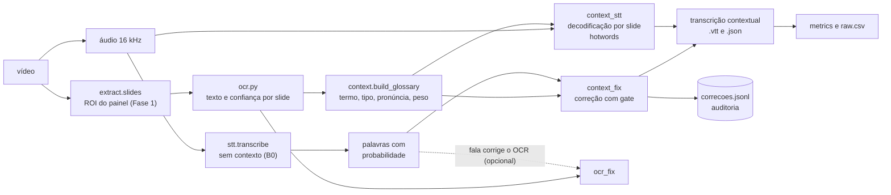

# Plano: F10, FalAI Contexto

**Transcrição guiada pelo slide e OCR corrigido pela fala**

> **Estado: implementado em 2026-11-12** (fases 0 a 6 em código e testes; ver a seção 4.11 em diante do
> [guia.md](../guia.md) e as decisões D14 a D20 em [decisoes.md](decisoes.md)). **Desvios do plano:** a correção só
> mira siglas e nomes (palavra comum do slide não é alvo) e tem mais duas salvaguardas, achadas num teste com áudio real
> (D16); o relatório e o Studio mantêm a RQ1 e o contexto em tabelas separadas. **Ficaram de fora:** a automação da RQ8
> (OCR degradado), a RQ9 (fala corrige o OCR), o modo R, as telas de anotação dos gabaritos e a auditoria às cegas
> das diferenças entre dois sistemas. Não há resultado de nenhuma RQ: faltam vídeos com licença e gabarito (etapa 1).
> O texto abaixo é o plano original. Substitui a proposta de modo ao vivo
> ([plano_ao_vivo.md](plano_ao_vivo.md), descartada). Os números da seção 1 são **diagnósticos de
> planejamento**, medidos nesta máquina nos vídeos de teste locais. Não são resultados do artigo (regra 2).
> Estimativas de esforço são `[PLACEHOLDER]`.

---

## 0. Resumo

Hoje o FalAI roda STT e OCR **separados**. A página só os junta na busca por substring. Mas, numa aula de
slides, o slide mostra **por escrito** as palavras que mais derrubam o STT: siglas, nomes e termos técnicos
(as categorias `sigla`, `nome_proprio` e `termo_tecnico` da análise de erros, D12). A proposta é **fundir as
modalidades**:

- o texto do slide que está na tela guia a decodificação do Whisper naquele trecho;
- um passo de correção troca palavras de baixa confiança pelo termo do slide, com auditoria;
- (opcional) a fala corrige o OCR de texto pequeno.

> **Pergunta:** o texto do slide visível melhora a transcrição dos termos técnicos? Quanto custa em tempo?
> O ganho aumenta com o ruído? E a fusão sobrevive a um OCR ruim?

É o terceiro eixo da pergunta central (qualidade × tempo × ruído), sem infraestrutura nova: usa WER, CER,
`acerto_termos`, RTF e as telas Erros e A/B do Studio.

**Por que é difícil de verdade:**

1. O alinhamento no tempo depende de um extrator de slides que hoje **não funciona** neste formato de aula
   (seção 1, S1 a S3).
2. O Whisper não aceita contexto que muda no tempo. Só dá para variar o contexto por trecho, e cortar o áudio
   gera erro nas bordas (armadilha 21).
3. O mecanismo de contexto tem uma pegadinha de implementação (S6): `initial_prompt` e `hotwords` se
   comportam de modo diferente com a configuração do projeto.
4. Siglas em português têm duas pronúncias (soletrada, "cê ême ene", e lida como palavra, "bacen"), e o ASR
   erra de formas diferentes em cada uma.
5. Sem controle, o ganho não prova nada: um prompt qualquer já muda a saída. Faz falta um glossário placebo e
   um oráculo.

**O que esta proposta não faz:** não toca o plano de entrega. A fronteira análise × transporte do enunciado
continua dependendo da F8. Uma versão barata em VOD (HLS pré-gerado, sem ao vivo) fica como complemento.

---

## 1. Evidência nos vídeos de teste

### 1.1 O banco de testes

Pasta `economia do dia cb/` (1,1 GB, 15 `.mp4`, 91,6 min, H.264 + AAC, 1080p ou 720p, 25 ou 30 fps).
Curso comercial sobre o Sistema Financeiro Nacional e o mercado de capitais, da plataforma Voomp Play. Os
vídeos "Dicas de prova" sugerem preparação para uma prova. **Sem licença anotada**: só banco de testes
local (seção 10). O assunto é cheio de siglas (CMN, BACEN, CVM, SPB, B3, IMFs, SELIC) e de nomes
(Tesouro Nacional, Dealers, Clearing houses), que é o cenário em que a ideia mais deveria ajudar.

| Layout | Descrição | Vídeos |
|---|---|---|
| L1 Câmera em tela cheia | Estúdio com microfone articulado | Abertura e encerramento de vários |
| L2 Slide em painel + miniatura | Painel preto numa moldura amarela texturizada, título numa fita cinza, bullets revelados aos poucos, miniatura da câmera no canto inferior esquerdo, rodapé fixo de rede social | `aula_02`, `VP`, `VP(1)`, `VP(2)`, `VP(3)`, `VP(7)`, `VP(8)` |
| L3 Slide + câmera em bolha | Bolha no canto inferior direito, ou slide pequeno ao lado da câmera | `aula01`, `VP(9)`, `VP(12)` |
| L4 Gravação de site + câmera + legenda queimada | Site do Banco Central com rolagem, legenda amarela no rodapé, 720p | `VP(4)`, `VP(5)` |
| L5 Cenário virtual + cartão de título | Só um cartão ("B3", "Investidor qualificado × profissional", "Clearing houses"); sem slide; outras pessoas apresentando | `VP(6)`, `VP(10)`, `VP(11)` |

(`VP` = `Voomp Play`.) Classificação feita olhando 6 quadros por vídeo: conferir. Há pelo menos três
aparências diferentes de quem apresenta, então o conjunto também varia voz e microfone. Durações de 2,6 a
15,5 min (`VP(7)`); `VP(4)`, `VP(5)`, `VP(9)` e `VP(12)` são 720p com fonte pequena.

### 1.2 O que as sondagens mostraram

Tudo em 2026-11-12, nesta máquina. Cada linha é uma observação de planejamento.

| # | Achado | Como foi obtido | Implicação |
|---|---|---|---|
| S1 | `extract.slides` com os parâmetros padrão acha **1 slide no total** (em `VP(7)`) nos 15 vídeos. Só os 3 vídeos L5 realmente não têm slide | `src/extract.py` em cada vídeo, 6 a 45 s por vídeo (4 em paralelo) | Sem slides não há contexto. A Fase 1 é pré-requisito |
| S2 | **Causa:** (a) com o quadro inteiro, a "tinta" dá 37% a 46% (limite `max_ink` = 30%), porque a moldura amarela conta como tinta; só no painel dá 8% a 18%. (b) `min_flat` mede o fundo liso no quadro inteiro com a mediana do quadro inteiro e **ignora o `roi`**. Como o painel preto ocupa ~51% do quadro, a mediana fica no fio da navalha: no `VP`, o fundo liso vai de 50,6% (180 s) para 1,7% (207 s) e daí em diante tudo é rejeitado | Script de diagnóstico sobre 7 quadros e rastreio das decisões do tracker em `VP` | O problema é de medida, não de limiar. Ajustar o limiar não resolve |
| S3 | Com `--roi` no painel e `min_flat=0`, o `VP` passa a ter o slide completo (9 estágios, 25 a 311 s) e o `aula_02` o organograma (5 estágios, 122 a 408 s). Mas a câmera em tela cheia vira "slide" (0 a 378 s e 0 a 430 s), que é o que o `min_flat` evitava. Só com `--roi`, o quadro guardado fica incompleto (1 objetivo de 5; sem o organograma) | `extract.slides(..., roi=..., min_flat=0.0)` e comparação visual com a tela | A correção certa é medir mediana e fundo liso **dentro da ROI**, não desligar o filtro. Para a câmera e o cenário em tela cheia o fundo liso deu 3% a 18% (`VP(6)` e `VP(10)`, quadro inteiro), contra 75% a 88% do slide dentro do painel: há margem para o filtro separar os dois, **a confirmar na Fase 1** |
| S4 | **Siglas erradas com a resposta na tela.** `medium` (o maior modelo da comparação), trecho de 3 min do `VP` (95 a 275 s), em que o slide "CMN" traz "BACEN" no texto: saiu "Bassim" (probabilidade 0,33), "cml" (0,15) e "CMR" (≥ 0,5) no lugar de BACEN, CMN e CMN. Outras 9 ocorrências de CMN saíram certas. "Pimek" e "PIMEC" (o mesmo nome em duas grafias, **fora** do slide) | Transcrição com `words.probability`; leitura do texto. **O áudio não foi ouvido** | A premissa vale até no maior modelo. Um gate por confiança pega 2 dos 3 erros, e o terceiro é confiante. Nomes fora da tela são o controle negativo |
| S5 | Com `hotwords="CMN, BACEN, SFN, Conselho Monetário Nacional"` no mesmo trecho, os três erros somem ("atividades do CMN", "BACEN"). "Pimek/PIMEC" continua inconsistente ("PMEC", "Pemec"). Um dos erros ("Bassim", 21 s) está na 1ª janela; "cml" está aos ~120 s e "CMR" perto do fim do trecho | Mesma sonda, 1 execução, `medium` em CPU/int8 (86 s para 180 s de áudio, só para dimensionar) | **Anedota** (n = 1, trecho escolhido por ter siglas, uma execução). Indica que o mecanismo age além da 1ª janela. Não é resultado |
| S6 | No faster-whisper 1.2.1 instalado, com `condition_on_previous_text=False`, o `initial_prompt` só chega à **primeira janela** (~30 s): ele entra em `all_tokens` (linhas 1143 a 1149), mas o `prompt_reset_since` avança ao fim de cada janela (1373 a 1383), e o prompt de cada janela é `all_tokens[prompt_reset_since:]` (1187). O `hotwords` entra em `get_prompt` a **toda** janela (1542), truncado a 223 tokens (`max_length` 448 // 2 − 1) | Leitura do código-fonte | A condição `limpo_vocab` (I5) provavelmente subestima o efeito do vocabulário (decisão C2). **Falta confirmar com um teste empírico** (spike S-b) |
| S7 | `device="auto"` escolhe `cuda`, e a inferência falha: `Library libcublas.so.12 is not found`. Tesseract não está instalado. O cache só tem o modelo `medium` | `stt.transcribe`; `which tesseract`; `~/.cache/huggingface` | Pré-requisitos de ambiente (seção 10) |

**Reproduzir S1 a S3** (a Fase 0 transforma isto em script versionado):

```bash
V="economia do dia cb/modulo 1/Voomp Play.mp4"
uv run python src/extract.py "$V" --out /tmp/vp                                  # padrão: 0 slides
uv run python src/extract.py "$V" --out /tmp/vp --roi 0.12,0.18,0.90,0.90        # 1 slide, quadro incompleto
# min_flat não é opção da CLI: extract.slides(V, out, 0.5, roi=(0.12,0.18,0.90,0.90), min_flat=0.0)
```

---

## 2. Alternativas consideradas

| Ideia | Resumo | Por que não agora |
|---|---|---|
| Pergunte à aula (F6 ampliada) | Índice híbrido (BM25 + embeddings + CLIP) sobre fala e slides, com resposta e citação | Já é a RQ3/F6 do backlog. Funciona melhor **depois** da F10, porque herda o texto corrigido (seção 13) |
| Apostila e vínculo slide ↔ fala | PDF com cada slide e o que foi dito nele | É saída, não experimento. Reaproveita `glossario.json` e os intervalos da Fase 1: vem quase de graça depois |
| Codificação para máquinas | Quanto comprimir áudio e vídeo antes de STT e OCR piorarem | Boa para a parte de rede, mas pede VMAF, encoders e outra matriz. Candidata a trabalho futuro |
| Modo ao vivo | STT em streaming + HLS ao vivo | Descartado pelo usuário |

---

## 3. Perguntas e hipóteses

Numeradas depois das do CLAUDE.md, seção 4. As hipóteses são registradas **antes** de rodar; resultado nulo
é reportável.

| RQ | Pergunta | Hipótese |
|---|---|---|
| RQ6 | O texto do slide visível melhora a transcrição dos termos técnicos? | **H1:** sim para siglas, nomes e termos que estão na tela; o WER global muda pouco; o ganho vem de `sigla`, `termo_tecnico` e `nome_proprio`. **H1b:** contexto alinhado no tempo (local) ≥ vocabulário global do vídeo > nenhum. **H1c:** o ganho não vem de "qualquer prompt": um glossário trocado (placebo) não reproduz o efeito |
| RQ7 | O ganho cresce com o ruído? | **H2:** cresce até um ponto (complementaridade entre modalidades, como no reconhecimento audiovisual de fala), e a 0 dB pode cair ou virar inserção. Direção não prevista |
| RQ8 | A fusão tolera OCR ruim? | **H3:** tolera as degradações da RQ2 (resize 0,5, blur 9, JPEG 30), mas um OCR que troca uma sigla por outra parecida contamina a transcrição |
| RQ9 (opcional) | A fala corrige o OCR de texto pequeno? | **H4:** em 720p com fonte pequena, a CER cai com a correção guiada pela fala |
| Custo | Quanto tempo a fusão acrescenta? | **H5:** OCR, glossário e re-decodificação somam um ΔRTF mensurável; a re-decodificação seletiva recupera parte |

---

## 4. Arquitetura



**Modos de contexto** (fator do experimento):

| Modo | O que é | Papel |
|---|---|---|
| B0 | Sem contexto (o que existe hoje) | Linha de base |
| G | Termos de maior peso do vídeo inteiro, em uma única chamada | I5 automático: separa "ter o vocabulário" de "tê-lo no momento certo" |
| P | Glossário **placebo**: mesmo tamanho e tipos, termos de outro vídeo, sem os que aparecem no `terms.txt` do trecho (todos os vídeos do curso são do mesmo assunto, então sem esse filtro o placebo poderia conter termos realmente falados) | Descarta o efeito de "qualquer prompt" |
| L | Glossário do slide visível, por intervalo | A proposta |
| O | Termos do `terms.txt` humano como `hotwords` | Oráculo: teto do ganho |
| L+F | L e, depois, correção com gate | A proposta completa |

---

## 5. Componentes

### 5.1 Fase 1: slides robustos ao layout (`extract.py`)

- **Mudança:** `SlideTracker` mede mediana, tinta e `flat` **dentro da `roi`** e fora de `ignore`, e não mais
  no quadro inteiro (S2). É mudança de comportamento do extrator: decisão C3 e `docs/decisoes.md`.
- **ROI automática** (`extract.find_panel`): amostra ~1 quadro a cada 5 s e escolhe o painel. Duas
  candidatas, a decidir no spike `[PREMISSA]`: (a) maior retângulo de fundo liso cercado por borda constante
  (serve ao L2); (b) mapa temporal de mudança: o painel é onde a tinta muda entre episódios, a moldura e o
  rodapé nunca mudam e a miniatura da câmera muda sem parar (a máscara de volatilidade já cobre este último).
  `--roi` continua como saída manual.
- **ROI de rastreio ≠ ROI de OCR.** O título fica na fita cinza que cobre a borda de cima do painel. O
  rastreio o exclui para ficar estável, e o OCR precisa dele: recorta o quadro sem moldura e sem rodapé.
- **L4 e L5 ficam fora do escopo da Fase 1.** L5 é controle (sem slide, o método não deve mudar nada). L4
  (rolagem de site e legenda queimada) é limitação documentada e caso de estresse.
- **Avaliação:** gabarito de tempo (`<video>.slides_t.json`, humano) em ≥ 5 vídeos de teste (L2 e L3).
  Métricas: slides achados × reais (início com tolerância de ±2 s), quadros incompletos (`n_stages` final
  menor que o real), duplicatas e falsos positivos de câmera. A linha de base é S1.
- **Não é custo exclusivo da F10:** o OCR da etapa 3 precisa disto para qualquer aula neste formato.

### 5.2 Fase 2: OCR por slide (`ocr.py`, etapa 3 já planejada)

Tesseract `por` e EasyOCR (RQ2). Pré-processamento para estes slides (texto claro sobre fundo preto):
recorte sem moldura e sem rodapé, inversão, ampliação 2× quando a altura é menor que 900 px (720p),
`--psm 6` × `4`. Devolve também a confiança por palavra (`image_to_data`), usada na seção 5.6. Remover
marcadores de lista ("•" vira "e" ou "o" no OCR) antes do glossário.

### 5.3 Fase 2: glossário por slide (`context.py`)

`build_glossary(slides_ocr) -> list[dict]`:

- **Tipos:** `sigla` (2 a 6 letras maiúsculas, ou com dígito: CMN, BACEN, B3); `nome` (sequências de
  palavras capitalizadas: "Banco Central do Brasil"); `termo` (palavra rara: IDF sobre os slides do **curso**,
  fora de uma lista de palavras funcionais); `numero` ("Lei Complementar nº 179").
- **Pronúncias:** siglas soletradas com os nomes das letras em PT-BR ("cê ême ene") e, se alternarem
  consoante e vogal, também como palavra ("bacen", "selic"). Guarda as duas.
- **Peso:** tipo, raridade, repetição no slide, estar no título.
- **Boilerplate:** termo presente em ≥ 50% dos slides do vídeo (rodapé, nome do curso) sai.
- **Janela:** o slide vale de `t − lead_s` até `t_end + lag_s` (quem apresenta cita o termo antes de trocar o
  slide); o slide vizinho entra com peso menor. `lead_s` e `lag_s` são parâmetros a calibrar na camada A.

### 5.4 Fase 3: decodificação com contexto (`context_stt.py`)

- `stt.transcribe` ganha o parâmetro `hotwords`. Hoje só existe `initial_prompt`.
- **Limite:** 223 tokens (S6), na prática ≤ ~30 termos, ordenados por peso.
- **Modo L:** para cada intervalo de slide, recorta o **array de áudio** `[t0 − m, t1 + m]` e chama
  `transcribe` com `vad_filter=True`. Não usar `clip_timestamps`: com ele o VAD é desligado (linha 885) e
  quebraria a regra de "mesmos parâmetros". Une os segmentos pela regra do **ponto médio** (o segmento fica
  com o intervalo que contém o seu ponto médio), sem duplicar nem perder fala nas bordas. Margem
  `m = 2 s` `[PREMISSA]`, com ablação em {0, 2, 5}.
- **Sem slide** (câmera, cartão): herda o glossário do último slide (`carry`) ou fica vazio (decisão C7).
- **Modo G:** uma chamada com os termos de maior peso do vídeo. Variante com `initial_prompt` para expor o
  efeito da primeira janela (S6).
- **Re-decodificação seletiva (R):** uma passada base e reprocessamento só das janelas com palavra de
  `p < τ` e glossário disponível. É a alternativa barata, se o ΔRTF do L pesar.
- **Parâmetros fixos iguais** aos do projeto: `language`, `beam_size`, `vad_filter`,
  `condition_on_previous_text=False`, `word_timestamps=True` (regra 5).
- **Vazamento do prompt:** o Whisper às vezes repete o glossário em silêncio. `clean_segments` ganha a
  regra "segmento só com termos do glossário" (`reason="vazamento"`). Muda o WER: decisão C5.

### 5.5 Fase 4: correção com gate (`context_fix.py`)

Sem modelo. Sobre as palavras da transcrição base, com `probability` e tempo:

1. Candidatas: trechos de 1 a 3 palavras com `p < τ` dentro de um slide (± `m`).
2. Comparação com os termos do glossário **daquele slide**: chave normalizada (minúsculas, sem acento,
   letras repetidas colapsadas), pronúncia soletrada e pronúncia como palavra, e distância de edição /
   Jaro–Winkler sobre uma chave fonética de PT-BR (G2P simplificado: `c` antes de `e`/`i` vira `s`, `ç` e `ss`
   viram `s`, `qu` vira `k`, `h` mudo...). Pares de teste vindos de S4: `Bassim → BACEN`, `cml → CMN`,
   `CMR → CMN`.
3. Troca só se `sim ≥ s_min`. Se o gate por confiança perder erros confiantes (S4: "CMR" tinha `p ≥ 0,5`),
   testar o critério de **1 edição de uma sigla do slide** sem gate de confiança.
4. Preserva a grafia do slide ("BACEN"). `norm()` iguala a caixa. A regra de siglas do gabarito precisa ser
   a mesma (C4).
5. **Toda troca vai para `correcoes.jsonl`**, para auditoria. Palavra com `p ≥ τ` fora do critério 3 nunca
   muda.

### 5.6 Fase 5 (opcional): a fala corrige o OCR (`ocr_fix.py`)

Palavras do OCR com confiança baixa (< 60 no `image_to_data`) são alinhadas à transcrição do intervalo e
trocadas pela palavra falada de maior similaridade, quando alta. Só vale quando quem apresenta lê o slide em
voz alta (nem sempre). Avaliação: CER e recall de palavras contra o gabarito de slides da RQ2.

### 5.7 Studio

Processar ganha o seletor de contexto. A/B compara `limpo` × `limpo@L` (a tela já existe). Erros conta por
categoria antes e depois. Tela nova **Correções**: auditoria cega (seção 7). Comando CLI equivalente
continua mostrado, como nas outras telas.

---

## 6. Métricas

| Métrica | Definição | RQ |
|---|---|---|
| WER, CER | `metrics.wer` e `cer` sobre `norm()` (inalterada) | RQ6 a RQ8 |
| `acerto_termos` | `metrics.term_accuracy` com o `terms.txt` **humano**, nunca derivado do OCR (circularidade) | RQ6 a RQ8 |
| `acerto_termos_slide` e `_fora` | O mesmo, dividido: termos que estavam no slide naquele instante × que não estavam. O `_fora` é o controle negativo | RQ6 |
| `falsos_positivos` | Termos inseridos que não estão no gabarito (`term_accuracy` já devolve) | RQ6 (vazamento) |
| `taxa_alteracao` | Palavras mudadas ÷ palavras do texto base | Diagnóstico |
| `precisao_correcoes` | Das N trocas do modo F, quantas a auditoria cega marcou como certas | RQ6 |
| `win_rate` | Nos trechos em que dois sistemas diferem, % em que o contexto é preferido, com IC (bootstrap) | Camada A |
| Calibração da confiança | P(palavra errada \| faixa de `probability`), pelo alinhamento de `metrics.align`; curva de confiabilidade e ECE | Subproduto |
| ΔRTF | (tempo de OCR + glossário + decodificação) ÷ duração − RTF base. Carga e aquecimento fora, como no protocolo | Custo |
| Slides (Fase 1) | Precisão e recall do início (±2 s), quadros incompletos, duplicatas, falsos positivos de câmera | Fase 1 |

---

## 7. Experimentos

**Duas camadas**, porque os vídeos do curso não têm licença nem gabarito de fala completo (regras 3 e 4):

### Camada A: banco de testes local (15 vídeos). **Não entra no artigo.**

Serve para desenvolver, calibrar e demonstrar.

1. **Slides × gabarito de tempo** (5 vídeos de L2 e L3, seção 5.1).
2. **Auditoria cega das diferenças:** nos trechos em que B0 e L (ou L+F) diferem, a pessoa **ouve** o trecho e
   escolhe A, B, ambos ou nenhum, sem saber qual é qual (ordem sorteada, seed fixa). É um julgamento de
   preferência, não a correção de uma saída de modelo (regra 3). Vale só para comparar sistemas, não para
   WER absoluto. Meta: ≥ 100 trechos.
3. **Gabarito parcial de termos** em 6 trechos de 2 a 3 min (5 em L2 e L3, 1 em L5 como controle): a pessoa
   anota, **ouvindo**, cada ocorrência falada de termo técnico (instante aproximado e termo). Pode consultar
   o slide só para a grafia. Custo estimado ≈ 5 min por trecho `[PLACEHOLDER]`, bem menor que a transcrição
   completa (15 a 20 min). Permite `acerto_termos` sem WER.
4. **Calibração** de `τ`, `s_min`, `m`, `lead_s`, `lag_s` e do tamanho do glossário. **Os valores são
   congelados antes da camada B.**

### Camada B: dataset oficial (6 vídeos próprios ou livres, com gabarito; etapa 1)

| Fator | Níveis |
|---|---|
| Modelo | `tiny`, `base`, `small` |
| Ruído | limpo, 20, 10 e 0 dB |
| Contexto | B0, G, P, L, L+F |
| Trechos | 6 |
| Repetições | 3 (tempo; o WER é quase determinístico, mas há o *fallback* de temperatura) |

3 × 4 × 5 × 6 = **360 configurações, 1080 execuções**, mais o oráculo O no limpo e em 10 dB (+36
configurações). O tempo de máquina depende de a GPU funcionar
(S7); medir no spike. **Grade reduzida** sem GPU: `tiny` e `base`, limpo e 10 dB, B0, G, L e L+F, 1
repetição de WER e 3 só de tempo no melhor (96 configurações).

- **Pré-requisito do dataset:** os vídeos próprios precisam ter slides com vocabulário técnico, senão não há
  o que medir. Incluir ≥ 1 com slide em tela cheia e ≥ 1 com miniatura da câmera.
- **Ablações:** margem `m` em {0, 2, 5}; `τ` em {0,3; 0,5; 0,7}; glossário em {10, 30, 60} termos; `carry`
  ligado/desligado; `initial_prompt` × `hotwords`; **OCR degradado** com as condições da RQ2 (RQ8).
- **Estatística:** bootstrap pareado sobre **ocorrências de termos e trechos** (há muito mais ocorrências do
  que vídeos). IC, n sempre visível, nenhum "p < 0,05" tratado como prova. 6 trechos não permitem generalizar.
- **Mesma máquina e mesmo dispositivo** em todas as execuções (regra 6). O hardware vai no artigo.

---

## 8. Contratos propostos

> Mudança de contrato: precisa de aprovação (regra 7) e entra no `guia.md`, seção 5, na mesma entrega. Versão
> *minor* do guia: as linhas antigas do `raw.csv` continuam válidas.

**8.1 `glossario.json`** (por vídeo, em `data/derived/<v>/`):

```json
[{"slide": "0003.png", "t": 25.0, "t_end": 311.0,
  "terms": [{"text": "BACEN", "kind": "sigla", "weight": 0.82, "pron": ["bê a cê e ene", "bacen"]},
            {"text": "Conselho Monetário Nacional", "kind": "nome", "weight": 0.9, "pron": []}]}]
```

**8.2 `correcoes.jsonl`**, uma linha por troca:
`{"t": 21.3, "antes": "Bassim", "depois": "BACEN", "p": 0.33, "sim": 0.81, "slide": "0003.png", "auditoria": null}`

**8.3 `results/raw.csv`.** Mesmas colunas. `condicao` vira `<ruído>@<contexto>`: `limpo@G`, `limpo@P`,
`limpo@L`, `snr10@L+F`, `limpo@O`. As linhas atuais (`limpo`, `snr10`...) são o B0 e continuam valendo.
Métricas novas: `acerto_termos_slide`, `acerto_termos_fora`, `falsos_positivos`, `taxa_alteracao`,
`precisao_correcoes`. O tempo extra vai numa linha `tempo_ctx` (como `tempo_llm` e `carga_modelo`), com
`tempo_s` = OCR + glossário + re-decodificação e sem valor.

**8.4 `data/gt/<v>.slides_t.json`** (humano): `[{"t": 25.0, "t_complete": 275.0, "t_end": 311.0, "titulo": "CMN – Conselho Monetário Nacional"}]`.

**8.5 `data/gt/<v>.termos.tsv`** (humano, ouvindo o áudio): uma linha `t_s<TAB>termo` por ocorrência falada.

---

## 9. Fases e trilhas

Cada fase tem critério de pronto, como as etapas do CLAUDE.md. Esforço em pessoa-dia, `[PLACEHOLDER]`.

| Fase | Entrega | Pronto quando | Esforço |
|---|---|---|---|
| **0. Spikes** | S-a: S1 a S3 em script versionado. S-b: teste empírico de `initial_prompt` × `hotwords` por janela (um termo dito aos 100 s). S-c: Tesseract nos layouts L2 e L3. S-d: custo de chamar `transcribe` por slide × uma passada. Decisões C2 e C3 | Observações em `docs/decisoes.md` (como anotação, não resultado) | 1–2 |
| **1. Slides robustos** | Seção 5.1 | Precisão e recall de slides contra o gabarito de tempo em 5 vídeos; teste de regressão passa | 3–4 |
| **2. OCR e glossário** | Seções 5.2 e 5.3 | `glossario.json` conferido à mão em 3 vídeos | 3–4 |
| **3. Contexto G, P, L** | Seção 5.4 e `run_experiments.py --context` | Matriz reduzida num trecho; auditoria cega no Studio funcionando | 4–5 |
| **4. Correção F** | Seção 5.5 | `precisao_correcoes` medida em ≥ 100 trocas | 3–4 |
| **5. Experimentos** | Seção 7, camada B | `raw.csv` completo; tabelas e figuras pelo `report.py` | 3–4 |
| **6. Integração** | Seção 13 | Demo do A/B com vídeo próprio ou licenciado | 3–4 |
| **7. Extras** | Fala → OCR (5.6); F6 com o texto corrigido; apostila | — | — |

| Trilha | Fases | Esforço | O que o artigo ganha |
|---|---|---|---|
| Mínima | 0 a 3 + Fase 5 enxuta (RQ6, só no limpo, com G, P e L) | 12–17 | RQ6: o ganho do contexto alinhado, com placebo |
| Média | 0 a 5 | 17–23 | + correção com auditoria e RQ7 (ruído) |
| Completa | 0 a 6 | 20–27 | + RQ8, demo e integração. Extras à parte |

**Calendário.** Hoje é 12/11 e a apresentação é em dezembro (data `[PENDENTE]`). Com estas estimativas
`[PLACEHOLDER]`, só a trilha mínima cabe sem dedicação integral. A Fase 1 já é pré-requisito da etapa 3 (OCR) em vídeos neste formato, então não conta como
escopo extra. Parar sempre na fronteira de uma trilha, nunca no meio de uma fase.

---

## 10. Dados, direitos e ambiente

- **Vídeos do curso** (comerciais, sem licença): só banco de testes local (regra 4). Nada deles vai para o git,
  o artigo ou os slides: nem quadros, nem trechos de áudio, nem transcrições, nem a legenda queimada. Se a
  equipe quiser citar resultados, pedir autorização `[VALIDAR]`. O `.gitignore` cobre `*.mp4` e `*.wav`, mas
  **não a pasta**: PNG, JSON e SRT gerados dentro dela apareceriam como não rastreados. Sugestão:
  acrescentar `economia do dia cb/` ao `.gitignore`.
- **Pessoas nos vídeos:** não identificar nem reproduzir imagem.
- **Legenda queimada** de `VP(4)` e `VP(5)`: origem desconhecida, possivelmente automática. **Não serve de
  gabarito** (regra 3). Serve de caso de estresse do rastreio.
- **Ambiente (o usuário executa; regra 8):**
  - Tesseract e o idioma português: `sudo pacman -S tesseract tesseract-data-por`.
  - GPU: o host não tem cuBLAS (o `ldconfig` não lista nenhuma biblioteca CUDA). Instalar o CUDA 12 ou
    usar o contêiner com o NVIDIA Container
    Toolkit. Sem isso, rodar com `device="cpu"` e a grade reduzida.
  - Modelos `tiny`, `base` e `small` são baixados na primeira execução (só `medium` está em cache).
- **Código:** `stt.resolve_device("auto")` escolhe `cuda` sem checar o cuBLAS e a inferência falha. Cair para
  CPU nesse caso muda o código (decisão C9).

---

## 11. Testes

Sem rede e sem carregar modelo (regra do projeto).

| Arquivo | Cobre |
|---|---|
| `tests/test_context.py` | Glossário com OCR fabricado: siglas, nomes, boilerplate por frequência, pronúncias soletrada e como palavra |
| `tests/test_context_fix.py` | Pares de S4 (`Bassim → BACEN`, `cml → CMN`, `CMR → CMN`); não troca com `p ≥ τ`; não troca fora do glossário do slide; registro em `correcoes.jsonl` |
| `tests/test_context_stt.py` | Com `asr` falso: união pelo ponto médio sem duplicar nem perder; margens; `hotwords` diferentes por intervalo; `carry` |
| `tests/test_extract.py` (ampliado) | **Regressão de S2:** quadro sintético com painel de ~50% da área sobre moldura texturizada. O fundo liso não oscila quando medido na ROI. `find_panel` |
| `tests/test_metrics.py` (ampliado) | `acerto_termos_slide` e `_fora` |

---

## 12. Riscos

| Risco | Mitigação |
|---|---|
| Ganho pequeno ou nulo | Hipóteses registradas antes (seção 3). Placebo e oráculo dão o piso e o teto. Resultado nulo é reportável |
| Vazamento do prompt, termos inventados | `falsos_positivos`, `clean_segments` ampliado, modo P |
| Correção troca um nome certo por outro do slide | Gate, glossário do slide atual, auditoria cega. `precisao_correcoes` reportada, não escondida |
| Rastreio de slides não generaliza | Fase 1 com gabarito de tempo. L4 fora do escopo, L5 como controle |
| OCR ruim em fonte pequena | RQ8, pré-processamento, `ocr_fix` |
| Ajustar limiares no próprio teste | Congelar parâmetros na camada A antes de rodar a B |
| Amostra pequena (6 trechos) | Bootstrap sobre ocorrências, IC, n visível |
| GPU indisponível no host | cuBLAS ou contêiner; grade reduzida; mesmo dispositivo em tudo |
| Direitos dos vídeos | Seção 10 |
| Anotação humana | Gabarito parcial de termos; auditoria só das diferenças |
| Esforço subestimado | Trilhas de corte (seção 9) |

---

## 13. Integração com o resto do projeto

- **`report.py`:** tabela 6 (`tabela6_contexto`: WER, `acerto_termos_slide` e `_fora`, falsos positivos, por
  modelo × ruído × contexto); tabela 7 (`tabela7_custo_contexto`: ΔRTF); figura 5 (`fig5_ganho_termos_snr`:
  ganho de termos × SNR, uma linha por modelo, com IC); figura 6 (`fig6_calibracao_confianca`); figura 7
  (`fig7_placebo`: L × P × O).
- **Studio:** seção 5.7. Números só via `raw.csv` (regra 2).
- **F6 e apostila:** com o texto corrigido e o `glossario.json`, a busca da F6 e o PDF slide + fala ficam mais
  baratos. Se a F6 existir, medir o efeito do contexto na busca (MRR) é uma figura a mais.
- **Artigo:** fundamentação (contexto em ASR, fusão multimodal, calibração); metodologia (camadas A e B,
  placebo, oráculo); resultados (RQ6 a RQ8); limitações (seção 12).
- **Apresentação:** demo do A/B ("Bassim → BACEN") **com vídeo próprio ou licenciado**.
- **`guia.md`** sobe para 0.4: seções 4.11 a 4.13, contratos 5.12 a 5.16, parâmetros, armadilhas (S2, S6,
  S7) e testes. **`CLAUDE.md`:** F10 no escopo, RQ6 a RQ9 na matriz, módulos na estrutura de pastas. Só depois
  da decisão C1.

---

## 14. Decisões a tomar antes de começar

| # | Decisão | Proposta | Quem |
|---|---|---|---|
| C1 | A F10 entra no escopo? Qual trilha? | Opcional, ao lado da F8 e da F9; começar pela mínima e decidir a próxima depois da Fase 3 | Equipe |
| C2 | A condição `limpo_vocab` (I5) usa `initial_prompt`, que (S6) só vale na 1ª janela. Trocar por `hotwords`, manter as duas ou só documentar? | Rodar as duas e relatar a diferença. **Muda o número da I5** (regra 7) | Equipe |
| C3 | `extract.slides` mede mediana e fundo liso dentro da ROI (muda o comportamento do extrator) | Sim, com teste de regressão e registro em `docs/decisoes.md` (D14) | Equipe |
| C4 | Regra de siglas e termos nas regras de transcrição do README, **antes** do gabarito: escrever "CMN" como no material da aula, ou soletrar? | Como no material da aula, sem pontos | Equipe |
| C5 | Contrato do `raw.csv` (seção 8.3) e regra "vazamento" do `clean_segments` (muda o WER) | Como na seção 8.3 e 5.4 | Equipe |
| C6 | Formatos dos gabaritos novos (8.4 e 8.5) | Como propostos | Equipe |
| C7 | Trecho sem slide: herdar o glossário do último slide ou ficar sem | Rodar os dois (ablação `carry`) | — |
| C8 | Uso dos vídeos do curso | Só teste local até haver autorização | Usuário |
| C9 | `device="auto"` cair para CPU quando falta o cuBLAS | Sim, com teste de falha simulada | Usuário |

---

## 15. Perguntas prováveis na arguição

Todo integrante deve saber responder (regra 17):

1. Por que o `initial_prompt` só afeta a primeira janela com `condition_on_previous_text=False`, e o
   `hotwords` não?
2. Para que serve o glossário placebo? O que ele separaria de efeito do slide?
3. Por que `acerto_termos` usa termos humanos e não os do OCR? (Circularidade.)
4. A confiança por palavra do Whisper é calibrada? Como se mede e o que muda se não for?
5. Por que o extrator de slides rejeitava estes vídeos? Por que a mediana é instável perto de 50%?
6. Por que o ganho pode piorar a 0 dB?
7. Como a correção evita inventar palavras? O que ela não consegue corrigir? (Nomes que não estão na tela.)
8. E se quem apresenta não ler o slide? (O termo na tela não é o termo falado: peso e janela.)

---

## 16. Referências

Conferir versão, ano e URL antes de citar `[VALIDAR]`.

- H. Wang et al. *SlideSpeech: A Large Scale Slide-Enriched Audio-Visual Corpus*. ICASSP 2024 (arXiv
  2309.05396). Texto de slide como contexto para ASR de aulas.
- A. Radford et al. *Robust Speech Recognition via Large-Scale Weak Supervision* (Whisper). Já em
  `artigo/referencias.bib` (`radford2022`).
- OpenAI Cookbook. *Whisper prompting guide* (uso do prompt para grafia de siglas e nomes).
- faster-whisper (SYSTRAN): parâmetros `initial_prompt` e `hotwords`. Já em `referencias.bib` (`fasterwhisper`).
- T. Afouras et al. *Deep Audio-Visual Speech Recognition*. IEEE TPAMI, 2018. A informação visual ajuda mais
  quando o áudio degrada.
- C. Guo et al. *On Calibration of Modern Neural Networks*. ICML 2017 (ECE e curva de confiabilidade).
- M. Bisani e H. Ney. *Bootstrap estimates for confidence intervals in ASR performance evaluation*. ICASSP
  2004.
